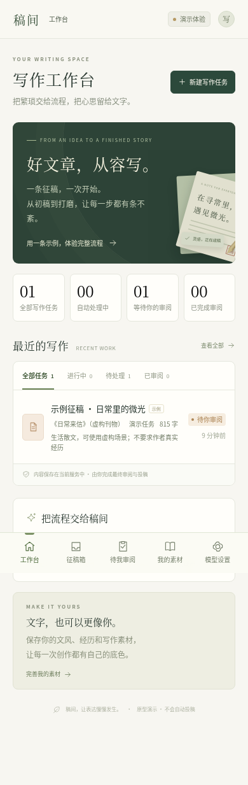

# 稿间 · 征稿写作工作台

适配手机和电脑的单人网页原型。导入征稿后，自动提取要求、生成初稿、进行两路独立评审及有限轮修改，最后由作者审阅和导出。原有 Scrapy 汽车爬虫保持不变，本项目位于独立目录。

## 手机界面

下图使用虚构的演示征稿与本地模板稿件，不含真实投稿或个人数据。



## 启动

需要 Python 3.12 或更新版本。通过 GitHub 下载 ZIP 后先解压，在解压后的仓库目录进入 `writing-studio` 文件夹。

macOS / Linux 首次安装：

```bash
cd writing-studio
python3 -m venv .venv
source .venv/bin/activate
python -m pip install -r requirements.lock
bash run.sh
```

Windows 在仓库目录打开 PowerShell，执行：

```powershell
cd writing-studio
py -m venv .venv
.venv\Scripts\python -m pip install -r requirements.lock
.venv\Scripts\python -m uvicorn app:app --host 127.0.0.1 --port 8000
```

服务默认监听本机 8000 端口。浏览器访问该端口即可使用。若需要从同一可信局域网的手机访问，可设置 `WRITING_STUDIO_HOST=0.0.0.0` 后启动，用电脑的局域网 IP 和 8000 端口访问。尚未包含多用户登录，请在本机或可信网络运行。

Windows 手机访问时，把启动命令中的 `--host 127.0.0.1` 改成 `--host 0.0.0.0`。手机和电脑须在同一网络，电脑防火墙也需要允许该端口的局域网访问。

可用 `WRITING_STUDIO_PORT` 更改端口，用 `WRITING_STUDIO_DATA` 指定数据目录。默认保存在本目录下被 Git 忽略的 `data/`，包含数据库、稿件、设置与截图。备份时停止服务后复制该目录。密钥保存在仅当前用户可读写的本地数据库，不返回给网页；数据库未进行额外的磁盘加密。

## 体验流程

1. 打开工作台，自带一条明确标记为虚构的示例征稿，后台会完成演示任务。
2. 新建任务，可以粘贴征稿正文、输入文章链接，或上传最多 8 张 JPG/PNG/WebP 截图（每张最多 5 MB）。
3. 先选择“演示模式”，不需要 API 密钥。演示生成和点评使用本地规则与模板，界面、导出稿件均有演示标记，不能作为真实模型效果或投稿作品。
4. 查看任务的要求、稿件版本、两路评审、硬性检查和待处理事项。手动编辑后，旧评审会失效；可以提交定点修改意见进行重写和重新评审。
5. 完成最后确认后标记已审阅，可导出 Word、纯文本或邮件草稿。应用没有发送邮件、投稿或发布功能。

## 真实模型

在“模型设置”填写 OpenAI-compatible HTTPS API 地址、密钥、写作模型 ID 和评审模型 ID，然后在新建任务时选择真实模式。可为评审配置独立供应商的地址和密钥；留空地址时复用写作服务。两路评审使用独立上下文和不同检查重点，默认使用同一评审模型。

视觉模型为可选项，填写供应商支持图片输入的模型 ID 后可以识别截图。没有视觉模型时，截图任务会进入待补充状态，可粘贴正文继续；不会制造 OCR 结果。截图先按界面中排列的顺序发送，重叠内容的整理效果依赖真实模型，需要最后核对关键日期和投稿地址。

若运行环境限制外部网络，还需在环境设置中放行所选 API 服务的主机名，以及用于链接导入的 `mp.weixin.qq.com`。当前原型不自动修改网络规则；正文导入和本地演示无需这些外部连接。

也可通过 `WRITING_API_KEY` 注入写作服务密钥。客户端会员通常不提供 API 额度，需要自行开通供应商接口。

应用显示 token 用量及可配置的每日调用预算。模型不返回用量时采用保守估算，并标记估算状态。这不是人民币费用上限：不同模型的价格及 token 计算方式由供应商决定，建议同时在供应商侧设置费用限额。请求失败或响应丢失时，供应商实际计费也可能与本地记录存在差异。

## 自动流程与边界

- 自动修改上限为 1–3 轮。已完成的阶段、稿件版本与任务状态写入 SQLite；重启后从未完成步骤继续。中断瞬间正在执行的远程请求无法保证不被重复计费。
- 征稿原文明确禁止 AI 时停止生成；过期征稿停止生成；真实经历类征稿缺少素材时暂停。信息不完整的征稿会显示待确认项，作者最终核实。
- 字数统计采用中文汉字逐字、英文与数字连续串按词计数，忽略标点和空白，并在检查中说明口径。
- 链接导入限于 `mp.weixin.qq.com` 公众号文章的公共 HTTP/HTTPS 访问，禁止访问私有或回环地址，并检查重定向和响应大小。公众号可能拒绝服务端读取，此时可以在原任务补充正文。其他站点请粘贴正文。
- 一次任务处理一条征稿。合集文章应先截取目标征稿的完整段落；自动拆分多条征稿尚未实现，检测到多组明确的征稿方字段时会暂停并要求选择。
- 不包含微信公众号的每日自动订阅、登录微信、突破访问限制或自动操作第三方聊天客户端。
- 素材库是简单的作者素材文本，当前未实现逐条授权标签和向量检索。只应存放允许发送给所选模型的内容；设置真实模式后，这些素材和征稿正文会发给对应模型供应商。
- 任意模型之间意见一致不等于事实已核实；不保证录用、原创性认定或稿费。最终审阅由作者完成。

## 验证

```bash
python -m unittest -v test_app test_engine
```

测试使用独立临时数据库和本地演示引擎，不调用收费模型。机器可读接口定义路径为 `/openapi.json`，健康检查路径为 `/api/health`。真实供应商接入需要有效配置后另行验证，演示测试不能代表真实 API 已验证。

当前验证记录：25 项后端与模型协议测试通过；Chromium 桌面 1440px、手机 390px 浏览器流程通过，包括正文创建、未配置模型提示、两路评审、版本查看、编辑、定点修改、最终确认、Word 下载、截图排序及正文回补、素材保存和页面刷新。没有执行真实供应商 API 或实际 OCR 请求，也没有发送投稿。

## 文件

- `app.py`：HTTP 接口、后台任务调度、审阅门禁和文档导出。
- `engine.py`：规则提取、演示流程、真实模型调用、截图识别和链接读取。
- `store.py`：SQLite 存储。
- `static/`：无需构建步骤的响应式前端。
- `test_app.py`：隔离的功能集成测试。
- `test_engine.py`：通过本地模拟响应验证模型协议、预算和来源边界。
- `requirements.lock`：此次验证使用的完整依赖版本；`requirements.txt` 记录直接依赖。

这是可运行的单人原型。公网部署前需要增加身份认证、HTTPS 入口及相应的访问与资源管理。
